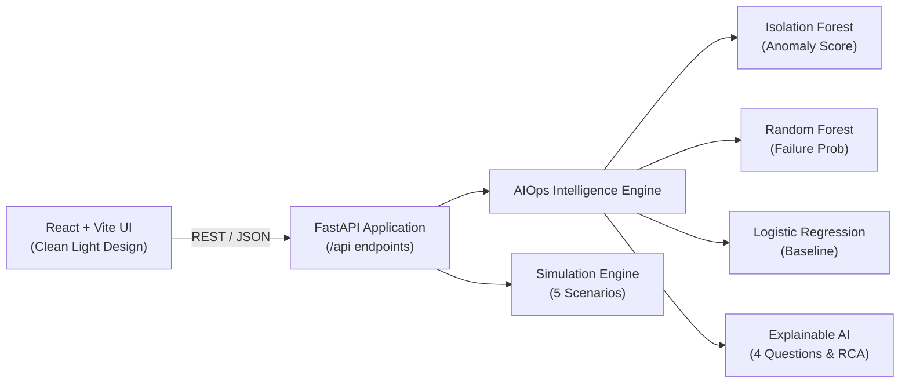

# AIOps Sentinel

### Explainable AI-Powered Infrastructure Failure Prediction and Intelligent Root Cause Analysis Platform

[](https://fastapi.tiangolo.com/)
[](https://react.dev/)
[](https://scikit-learn.org/)
[](https://aiops-sentinel-roan.vercel.app)
[](https://github.com/maxx6174/AIOps-Sentinel-)
[](https://opensource.org/licenses/MIT)

**Live Production Frontend**: [https://aiops-sentinel-roan.vercel.app](https://aiops-sentinel-roan.vercel.app)  
**Public GitHub Repository**: [https://github.com/maxx6174/AIOps-Sentinel-](https://github.com/maxx6174/AIOps-Sentinel-)

---

## 1. Project Overview

**AIOps Sentinel** is a human-designed, production-ready observability platform that monitors IT infrastructure, detects abnormal system behavior, predicts impending infrastructure failures, and explains the probable root causes behind those failures in plain engineering terms.

Designed specifically for enterprise cloud environments and university engineering research demonstrations (Vel Tech University), the platform answers four critical operational questions:

1. **What is happening in the infrastructure?** &mdash; Real-time multivariate telemetry tracking (CPU, Memory, Disk, Latency, Error Rate).
2. **Why is the abnormal behaviour occurring?** &mdash; Unsupervised anomaly isolation and local feature attribution.
3. **What could happen next?** &mdash; Probabilistic failure likelihood calibrated by ensemble decision trees.
4. **What action should be taken?** &mdash; Clear, automated remediation playbooks derived from system diagnostic signatures.

---

## 2. Design Philosophy: Simple Appearance, Powerful Functionality

The user interface follows a modern, human-designed aesthetic:
- **Clean light theme** with white (`#ffffff`) and subtle light-slate surfaces (`#f8fafc`).
- **Subtle blue primary accent** (`#2563eb`) with high readability and natural spacing.
- **No dark mode, no neon glow, and no artificial futuristic decorations.**
- Built for real systems engineers who need clear, distraction-free diagnostics during high-severity incidents.

---

## 3. Five Core Application Modules

| Module | Purpose | Key Features |
| :--- | :--- | :--- |
| **A. Operations Dashboard** | High-level system overview | Health banner, risk score gauge (0-100), active incident cards, 5-service health status, real-time rolling telemetry chart. |
| **B. Infrastructure Monitoring** | Deep time-series telemetry | Interactive charts for CPU, Memory, Disk, Latency, and Error Rate; detailed microservice registry table. |
| **C. AI Analysis & XAI** | Explainable AI & Diagnostic Engine | Anomaly status (Isolation Forest), Failure probability (Random Forest), 4 Core Questions, Empirical Evidence vs. Hypotheses, Local attribution breakdown. |
| **D. Live Simulation** | Interactive failure scenarios | 5 reproducible scenarios (Normal, CPU Overload, Memory Leak, Network Failure, Combined Cascade); Start, Pause, Resume, Reset controls; live telemetry feed. |
| **E. Data & Reports** | Batch dataset ingestion & audit | Multi-metric CSV upload, schema validation, batch inference, risk distribution charts, sample CSV download, plain-text audit report export. |

---

## 4. Machine Learning Benchmarks & Verification

Models were trained on a reproducible synthetic telemetry benchmark ($N = 6,000$ samples) with a **stratified 75% train / 25% test split** ($N_{\text{test}} = 1,500$) and strict data leakage prevention (scaler fitted strictly on training data).

| Model | Class | Accuracy | Precision | Recall | F1-Score | ROC-AUC |
| :--- | :--- | :---: | :---: | :---: | :---: | :---: |
| **Random Forest Classifier** | Supervised Non-Linear Ensemble (Primary) | **98.87%** | **93.73%** | **100.00%** | **0.9676** | **0.9952** |
| **Logistic Regression** | Supervised Linear Baseline | 98.73% | 94.34% | 98.43% | 0.9634 | 0.9935 |
| **Isolation Forest** | Unsupervised Anomaly Isolation | 95.67% | 89.11% | 89.40% | 0.8926 | 0.9876 |

### Random Forest Confusion Matrix ($N_{\text{test}} = 1,500$)
```
                      Predicted: Normal (0)    Predicted: Failure (1)
Actual: Normal (0)            1,229                      17
Actual: Failure (1)               0                     254
```
*Key takeaway: Zero false negatives ($FN = 0$) &mdash; 100% recall on true infrastructure failure states.*

---

## 5. System Architecture



---

## 6. Installation & Quickstart Guide

### Prerequisites
- Python 3.10+ (tested on Python 3.13)
- Node.js 18+ and npm

### 1. Clone & Set Up Backend
```bash
# Navigate to backend directory
cd backend

# Install Python dependencies
pip install -r requirements.txt

# Run model training and verification (generates dataset & models)
python -m app.ml.trainer

# Start the FastAPI server
python run_server.py
# Backend runs at http://127.0.0.1:8000 (OpenAPI docs at http://127.0.0.1:8000/docs)
```

### 2. Set Up Frontend
```bash
# Navigate to frontend directory in another terminal
cd ../frontend

# Install dependencies
npm install

# Start Vite development server
npm run dev
# Frontend runs at http://localhost:5173
```

---

## 7. Running Automated Test Suites

```bash
# Run all unit tests for ML, Simulation, Telemetry, and Root Cause Engine
cd backend
python -m unittest tests/test_all.py
```

---

## 8. University Project Demonstration (Vel Tech Evaluation)

For the complete 10-step judge demonstration procedure and answers to anticipated technical questions, consult:
- [`docs/UNIVERSITY_DEMO_GUIDE.md`](./docs/UNIVERSITY_DEMO_GUIDE.md)
- [`docs/ARCHITECTURE.md`](./docs/ARCHITECTURE.md)
- [`docs/ML_METHODOLOGY.md`](./docs/ML_METHODOLOGY.md)
- [`docs/EVALUATION_RESULTS.md`](./docs/EVALUATION_RESULTS.md)
- [`docs/API_DOCUMENTATION.md`](./docs/API_DOCUMENTATION.md)

---

## 9. Deployment Architecture

- **Frontend Deployment**: Ready for **Vercel** (`frontend/vercel.json` configured for SPA routing).
- **Backend Deployment**: Ready for **Render / Railway** (`backend/Procfile` and `backend/render.yaml` configured).

---

## 10. License & Academic Integrity

This project is open-sourced under the MIT License. All synthetic data generators and machine learning pipelines are fully reproducible and verified.
