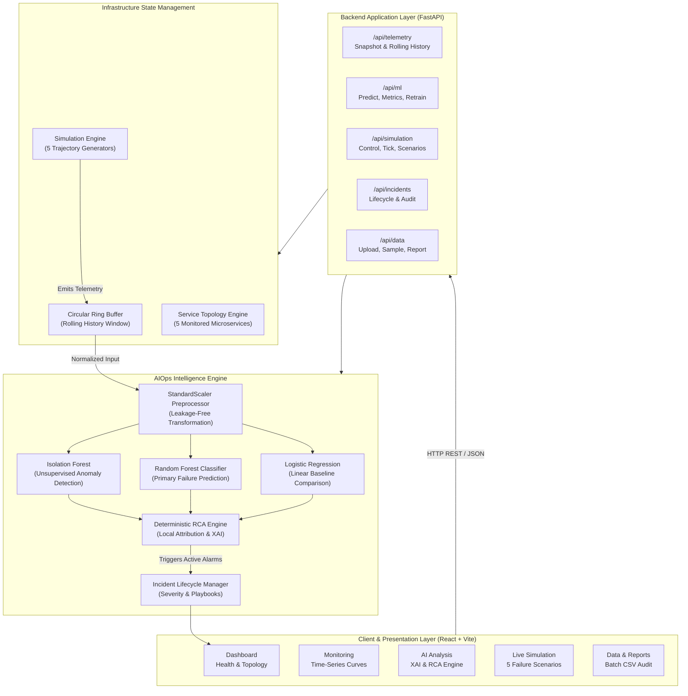

# AIOps Sentinel &mdash; System Architecture Specification

## 1. Executive Summary

**AIOps Sentinel** is an explainable AI-powered infrastructure failure prediction and root cause analysis platform designed for mission-critical distributed systems. It continuously ingests multivariate operational telemetry, detects anomalous operational drifts using unsupervised learning, forecasts failure probabilities using ensemble machine learning, and produces deterministic, explainable root cause analyses answering four fundamental operational questions:

1. **What is happening in the infrastructure?**
2. **Why is the abnormal behaviour occurring?**
3. **What could happen next?**
4. **What action should be taken?**

---

## 2. System Architecture Diagram

---

## 3. Data Flow Architecture

1. **Telemetry Ingestion**: Every 3 seconds, telemetry points containing five physical dimensions (`cpu_utilization`, `memory_utilization`, `disk_utilization`, `network_latency`, `error_rate`) are processed.
2. **Feature Standardization**: Features are scaled using `StandardScaler` fitted strictly on training distributions, completely avoiding data leakage.
3. **Dual-Model Inference**:
   - **Isolation Forest** computes path-length anomaly scores across tree isolation partitions, tagging inlier/outlier bounds.
   - **Random Forest** computes the failure likelihood probability $P(\text{Failure} \mid X)$ alongside the **Logistic Regression** baseline.
4. **Attribution & Explainability**: The Root Cause Analysis (RCA) engine contrasts observed measurements against baseline ranges, computes local feature importance impacts, and structures evidence versus hypothesis statements.
5. **Incident Automation**: High-risk predictions automatically register active incidents with actionable mitigation playbooks.

---

## 4. Monitored Microservice Topology

The platform models a production cloud microservice mesh:

| Node ID | Service Name | Architecture Role | Target Protocol | SLA Target |
| :--- | :--- | :--- | :--- | :--- |
| `srv-gateway` | API Gateway | Edge Traffic Ingress | HTTP / REST | 99.98% |
| `srv-auth` | Authentication Service | Identity Provider / JWT | OAuth / gRPC | 99.99% |
| `srv-payment` | Payment Engine | Core Transactional Service | REST / TLS | 99.95% |
| `srv-database` | PostgreSQL Primary | Relational Persistence | TCP / Wire | 99.99% |
| `srv-cache` | Redis Distributed Cache | In-Memory Session Store | TCP / RESP | 100.0% |

---

## 5. Security and Operational Design Principles

- **Separation of Evidence and Hypothesis**: Prevents operator confirmation bias by displaying verified empirical values in a separate channel from model-deduced probabilities.
- **Fail-Safe Baseline**: If machine learning modules experience pipeline disruption, the system falls back to statistical baseline standard deviation thresholding.
- **Strict Leakage Prevention**: Training and testing sets are partitioned with stratification before any preprocessing or parameter tuning.
